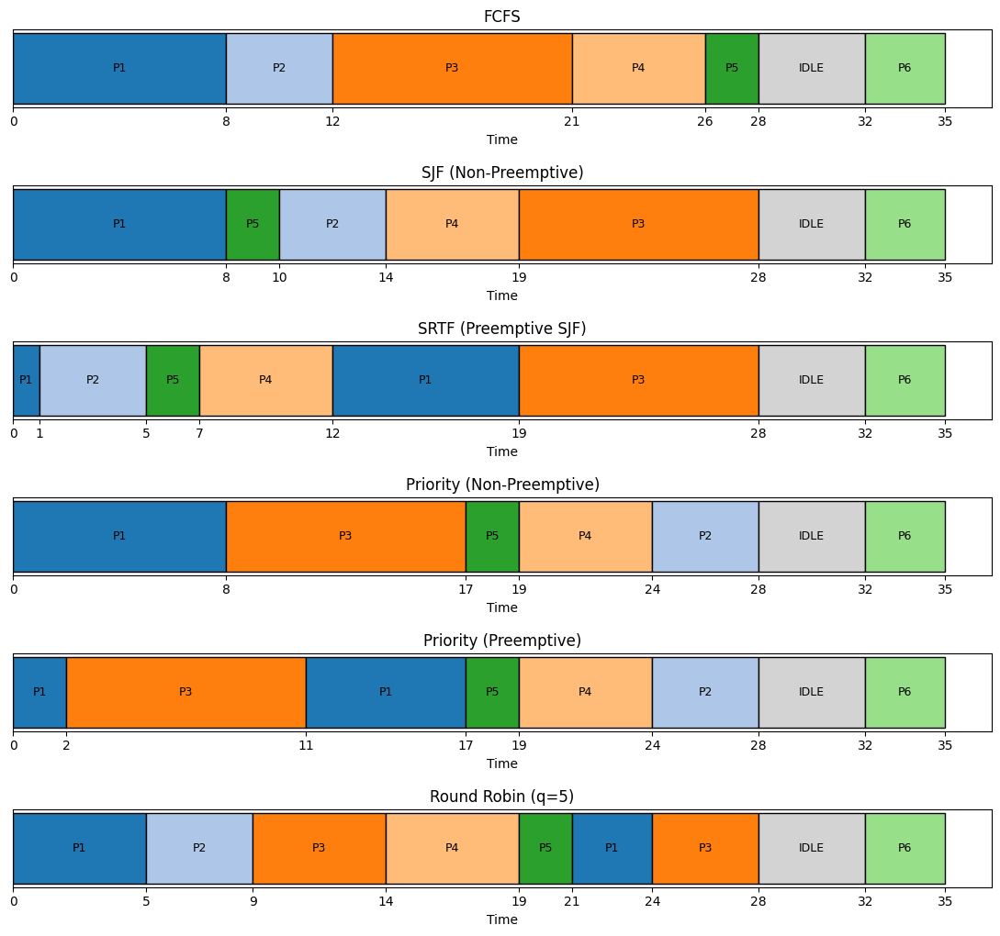
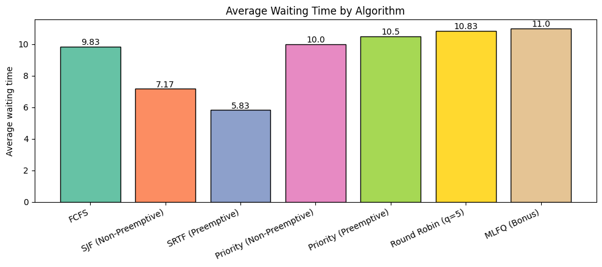
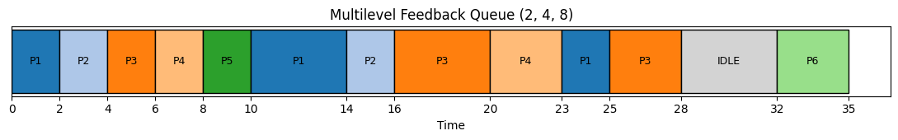

# CPU Scheduling Simulator

[](https://colab.research.google.com/github/YOUR-USERNAME/cpu-scheduling-simulator/blob/main/main.ipynb)


A Python simulator that runs CPU scheduling algorithms on a set of processes, calculates performance metrics, draws Gantt charts and compares which algorithm performs best. It is written as a Google Colab notebook, so it runs in the browser with no installation.

## Features

- **7 scheduling algorithms:** FCFS, SJF (non-preemptive), SRTF (preemptive SJF), Priority (non-preemptive), Priority (preemptive), Round Robin with a user-defined time quantum, and Multilevel Feedback Queue (MLFQ)
- **Per-process metrics:** completion, turnaround, waiting and response time
- **Averages and CPU utilization** for every algorithm
- **Gantt charts** in two forms: text-based and graphical (matplotlib)
- **Comparison mode:** runs every algorithm on the same input and prints one summary table, plus a bar graph of average waiting time
- **Flexible input:** built-in sample dataset, CSV file or keyboard input, with input validation
- **Edge cases handled:** CPU idle gaps, equal arrival times, and ties in burst time or priority
- **Built-in test cases** with hand-calculated expected results

## How it works

Every algorithm returns a **Gantt list**, which is a list of `(process, start, end)` blocks (an idle CPU appears as `IDLE`). All metrics are calculated from that one list, so the metric code is written only once:

| Metric | Formula |
|---|---|
| Turnaround time | completion time - arrival time |
| Waiting time | turnaround time - burst time |
| Response time | first time on the CPU - arrival time |
| CPU utilization | busy time / total time x 100 |

SJF and Priority (non-preemptive) share one function, and SRTF and Priority (preemptive) share another. Only the rule for choosing the next process is different.

## Algorithms

| Algorithm | Type | Picks the next process by |
|---|---|---|
| FCFS | Non-preemptive | Arrival order |
| SJF | Non-preemptive | Smallest burst time |
| SRTF | Preemptive | Smallest remaining time |
| Priority (NP) | Non-preemptive | Smallest priority number |
| Priority (P) | Preemptive | Smallest priority number, a new higher-priority process interrupts |
| Round Robin | Preemptive | Queue order, each process runs for at most one time quantum |
| MLFQ (bonus) | Preemptive | 3 queues (quantum 2, 4, 8); a process that uses its full quantum moves down one queue |

**Rules:** times are whole numbers. For priority scheduling a **smaller number means higher priority**. Ties are broken by earlier arrival time, then by input order.

## Input format

Each process has a **PID, arrival time, burst time and priority**. A CSV file looks like this:

```
PID,Arrival,Burst,Priority
P1,0,8,2
P2,1,4,4
P3,2,9,1
P4,2,5,3
P5,3,2,2
P6,32,3,2
```

This is the sample dataset used in all results below. It contains equal arrival times (P3 and P4), a burst-time tie, a priority tie and an idle gap (P6 arrives after the CPU has finished all earlier work).

## How to run

### Option 1: Open directly in Google Colab

1. Click the **Open In Colab** badge at the top of this page.
2. Choose **Runtime > Run all**.

### Option 2: Upload to Colab manually

1. Go to [colab.research.google.com](https://colab.research.google.com) and choose **File > Upload notebook**.
2. Select `main.ipynb` and choose **Runtime > Run all**.

### Option 3: Jupyter on your computer

```bash
git clone https://github.com/YOUR-USERNAME/cpu-scheduling-simulator.git
cd cpu-scheduling-simulator
pip install pandas matplotlib notebook
jupyter notebook main.ipynb
```

### Changing the settings

- **Time quantum:** change `QUANTUM` in the Round Robin cell (the default is `5`).
- **Run one algorithm:** use the dropdown in the "Choose and run any one algorithm" cell.
- **Your own data:** edit `sample_data` in the dataset cell, or upload a CSV with the columns `PID,Arrival,Burst,Priority`.

## Results

All results below use the sample dataset above with a Round Robin quantum of 5.

### Gantt charts



The text version of the same charts (as printed by the program):

```
FCFS
| P1 | P2 | P3 | P4 | P5 | IDLE | P6 |
0    8    12   21   26   28     32   35

SJF (Non-Preemptive)
| P1 | P5 | P2 | P4 | P3 | IDLE | P6 |
0    8    10   14   19   28     32   35

SRTF (Preemptive)
| P1 | P2 | P5 | P4 | P1 | P3 | IDLE | P6 |
0    1    5    7    12   19   28     32   35

Priority (Non-Preemptive)
| P1 | P3 | P5 | P4 | P2 | IDLE | P6 |
0    8    17   19   24   28     32   35

Priority (Preemptive)
| P1 | P3 | P1 | P5 | P4 | P2 | IDLE | P6 |
0    2    11   17   19   24   28     32   35

Round Robin (q=5)
| P1 | P2 | P3 | P4 | P5 | P1 | P3 | IDLE | P6 |
0    5    9    14   19   21   24   28     32   35
```

### Comparison table

| Algorithm | Avg Completion | Avg Turnaround | Avg Waiting | Avg Response | CPU Util % |
|---|---|---|---|---|---|
| FCFS | 21.67 | 15.00 | 9.83 | 9.83 | 88.57 |
| SJF (Non-Preemptive) | 19.00 | 12.33 | 7.17 | 7.17 | 88.57 |
| **SRTF (Preemptive)** | **17.67** | **11.00** | **5.83** | **4.00** | 88.57 |
| Priority (Non-Preemptive) | 21.83 | 15.17 | 10.00 | 10.00 | 88.57 |
| Priority (Preemptive) | 22.33 | 15.67 | 10.50 | 9.00 | 88.57 |
| Round Robin (q=5) | 22.67 | 16.00 | 10.83 | 6.50 | 88.57 |

CPU utilization is 88.57% for every algorithm because the CPU is idle from time 28 to 32 (31 busy units out of 35).

### Average waiting time



### Discussion

- **SRTF** gives the lowest average waiting, turnaround and response time on this dataset, because it always runs the process that will finish soonest. The cost is that long processes (here P3) can be delayed.
- **SJF** comes second. It cannot interrupt a running process, so short processes that arrive during a long job still have to wait.
- **FCFS** suffers from the convoy effect: P1, P3 and P4 are long, so the short processes P2 and P5 wait a long time behind them.
- **Priority scheduling** ignores job length, so its averages are higher here. The preemptive version responds faster than the non-preemptive one (9.00 vs 10.00), but finishes later on average.
- **Round Robin** shares the CPU fairly and gives a good response time (6.50), but its waiting time is higher than SJF and SRTF. The quantum matters: a very large quantum makes it behave like FCFS, a very small one adds many context switches.

### Bonus: Multilevel Feedback Queue

New processes enter the top queue (quantum 2). A process that uses its whole quantum without finishing drops to the next queue (quantum 4, then 8). The CPU always serves the highest non-empty queue, so short jobs finish quickly.



On the sample dataset MLFQ gives an average response time of 2.00, the best of all algorithms, with an average waiting time of 11.00.

## Testing

The notebook contains 3 test cases. Expected values were worked out **by hand**, then compared with the program output. All 10 checks pass.

| Test | What it checks | Expected | Result |
|---|---|---|---|
| Test 1: textbook set | P1(0,7), P2(2,4), P3(4,1), P4(5,4): average waiting time of FCFS / SJF / SRTF / Round Robin (q=2) | 4.75 / 4.00 / 3.00 / 5.00 | PASS |
| Test 2: CPU idle gap | P1(0,2), P2(5,3), P3(6,1): FCFS average waiting time, CPU utilization and Gantt order | 0.67, 66.67%, P1 IDLE P2 P3 | PASS |
| Test 3: equal arrivals and ties | All arrive at 0: Priority (NP) order, Priority (NP) average waiting time, FCFS average waiting time | P3 P1 P2 P4, 4.5, 5.5 | PASS |

## Project structure

```
cpu-scheduling-simulator/
├── main.ipynb          # the simulator (Google Colab notebook)
├── processes.csv       # sample input data
├── screenshots/        # Gantt charts and comparison graph used in this README
├── .gitignore
└── README.md
```

## Built with

- Python 3
- [pandas](https://pandas.pydata.org/) for the process table and results
- [matplotlib](https://matplotlib.org/) for the Gantt charts and comparison graph
- Google Colab

## References

- Silberschatz, Galvin, Gagne, *Operating System Concepts*
- Python, pandas and matplotlib documentation
